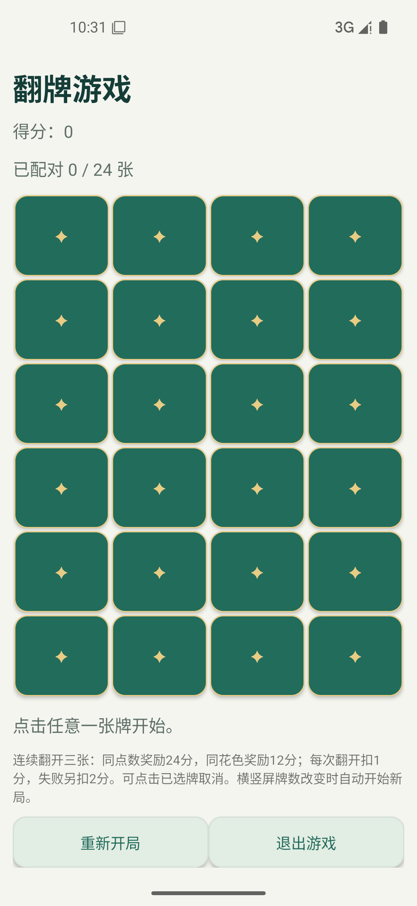
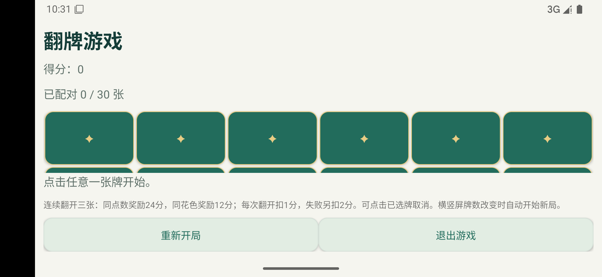

# 实验五 RecyclerView翻牌游戏应用实验报告
姓名：陈浩然　学号：2024110203　2024级2班
日期：2026年11月8日
项目：https://github.com/chaoran149-netizen/Android-Experiment-5

## 实验目的
掌握RecyclerView与Adapter、菜单与对话框，并在MVC结构中扩展实验四。

## 设计与实现
MainActivity负责个人信息与关于菜单；EditProfileActivity延用实验四的个人资料修改；GameActivity协调CardMatchingGame模型与CardAdapter视图。Adapter派生自RecyclerView.Adapter，重载创建、绑定和数量方法，使用Listener将点击反馈给控制器。回调位置实时读取getBindingAdapterPosition，并检查NO_POSITION，避免复用后的旧位置错误。

竖屏通过values/integers.xml配置24张牌4列；横屏通过values-land/integers.xml配置30张牌6列。两者均支持RecyclerView滚动。横竖屏牌数改变时模型reset(count)创建新局；相同牌数Activity重建时恢复保存的序列化模型。最高分不因重开降低。

三张牌匹配规则集中在Card.match和CardMatchingGame.chooseCardAtIndex：三张同点数match返回6，三张同花色返回3，奖励乘4。每次翻开扣1分，凑齐三张未匹配另扣2分并合上三张。已配对的牌禁用，选中未匹配牌可以免费取消。三张全同点数净得21分、同花色净得9分、失败净扣5分。没有可用三张组合则提示本局结束。

reset()使用当前牌数重开，并清零分数与选择状态。原有Button直接生成GridLayout的方式改为RecyclerView复用Holder；onBindViewHolder始终重设文字、背景、enabled、alpha、无障碍描述，防止滚动串牌。所有可见字符串集中在资源中，应用标题为姓名与学号。

## 主要代码
- app/src/main/java/cn/edu/sicnu/cardgame/CardAdapter.java
- app/src/main/java/cn/edu/sicnu/cardgame/GameActivity.java
- app/src/main/java/cn/edu/sicnu/cardgame/model/CardMatchingGame.java
- app/src/main/java/cn/edu/sicnu/cardgame/model/Card.java
- app/src/main/java/cn/edu/sicnu/cardgame/MainActivity.java

## 运行截图

## 测试
JUnit覆盖三同点数、三同花色、失配、取消选择、reset及52张唯一抽牌。设备测试覆盖关于菜单、RecyclerView适配器数量、点击计分、同方向Activity重建和真实横屏30张牌。原始XML测试结果附在test-results目录。未将模拟器结果冒充真机兼容性结果。

## Git分支与审核
Main以实验四为基线，实验五在Dev开发。GitHub平台由用户明确指定，替代文档中的Gitee。Main已设置PR保护、至少1人批准、管理员同样受限，禁止强制推送与删除。代码通过Dev提出PR，真实审核与合并需要另一位有权限的审核者，作者不能自批；没有绕过保护或伪造审核。

## 结果与分析
模型规则、控件复用和事件回调保持独立，规则变化不依赖Adapter。资源配置支持不同方向牌数。信息仅保存在进程内，进程结束不持久化。切换方向的明确新局策略避免同一牌局在移除牌后残留失效选择。后续可增加保存独立横竖屏牌局功能。
